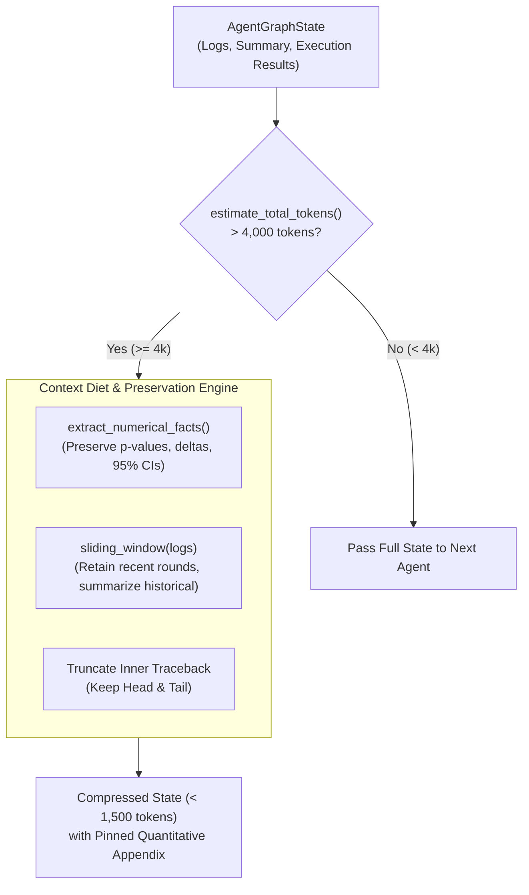

# Context Window Memory Manager (Member 1 - Lead, Week 3)

`src/memory/context_manager.py` manages token budgets and state memory across long-horizon, multi-agent scientific discovery iterations.

---

## 1. Problem & Architecture

In iterative scientific research (Reflexion loops, multi-trial code execution, and peer-review critiques), state history rapidly accumulates:
* Long literature summaries
* Multiple generated candidate hypotheses
* Extended execution traces and error tracebacks
* Multi-round agent discussion logs

Without intelligent memory pruning, prompt payloads exceed LLM context window bounds (e.g., 4,000 tokens), causing truncation errors, token budget exhaustion, or catastrophic forgetting of core quantitative metrics.



---

## 2. Key Capabilities

### A. Dual Token Estimation (`estimate_tokens`)
* Primary: Uses `tiktoken` (`cl100k_base`) when installed.
* Fallback: Employs a robust character-based heuristic (`~4 chars / token`) ensuring zero runtime crashes even in lightweight environments.

### B. Lossless Quantitative Preservation (`extract_numerical_facts`)
Scans experimental text using regex heuristics to preserve:
* $p$-values (e.g., `p-value: 0.014`, `p < 0.05`)
* Metric deltas (e.g., `Metric delta: +3.45`, `delta: 0.25`)
* Confidence intervals (e.g., `95% CI [1.2, 5.7]`)
* Benchmark means and variances (e.g., `Baseline mean: 98.2`, `Method mean: 101.65`)
* Cohen's $d$ effect sizes (e.g., `Cohen's d: 0.82`)

### C. Chronological Sliding Window (`sliding_window`)
Extracts the most recent execution rounds and agent dialogues while replacing older intermediate logs with an auto-summarized milestone bullet.

---

## 3. Python API & Usage

```python
from src.memory.context_manager import ContextManager

cm = ContextManager(max_context_tokens=4000, warning_threshold=0.85)

# Check if state is approaching context limits
if cm.is_near_overflow(state):
    state = cm.compress_state(state)

# Safe prompt construction
safe_prompt = cm.format_prompt_within_budget(
    system_prompt="You are a scientific evaluator.",
    context=large_context_text,
    user_prompt="Evaluate hypothesis falsifiability.",
    max_prompt_tokens=3000
)
```

---

## 4. Automated Tests

```bash
pytest tests/test_context_manager.py -v
```
All 10 unit tests verify token bounds, regex extraction accuracy, sliding-window retention, and state compression.
