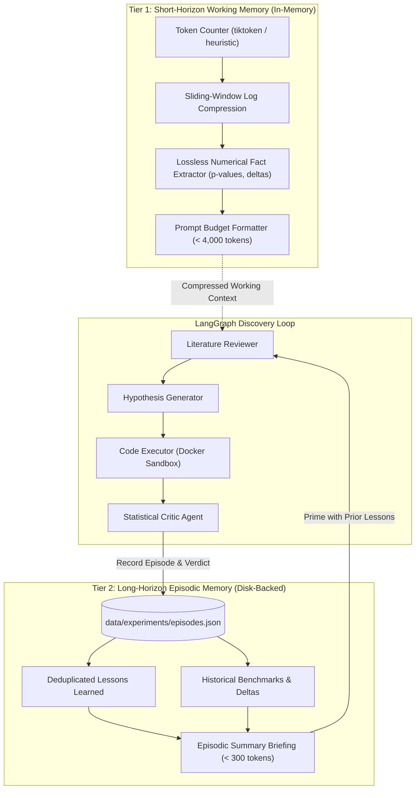

# Two-Tier Memory Architecture (Member 1 - Lead, Week 3)

The **Autonomous Multimodal Scientific Discovery Agent** implements a dual-layer memory hierarchy to support **multi-day, long-horizon autonomous research** without prompt token exhaustion or loss of empirical coherence.

---

## 1. Dual-Layer Memory Hierarchy



---

## 2. Tier Specifications

| Layer | Module | Persistence | Purpose | Capacity / Budget |
| :--- | :--- | :--- | :--- | :--- |
| **Tier 1: Working Context** | `src/memory/context_manager.py` | Transient (per session) | Prevents context window overflows during Reflexion loops and verbose tool outputs. | Hard ceiling at **4,000 tokens**; warning trigger at 85%. |
| **Tier 2: Episodic Memory** | `src/memory/episodic_memory.py` | Permanent (`data/experiments/episodes.json`) | Maintains continuity across multi-day sessions; prevents repeating rejected hypotheses. | Retains unlimited episodes; distilled to **$\le 300$ tokens** when priming agents. |

---

## 3. How Multi-Day Coherence Is Maintained

1. **Episodic Recording:** When an experiment completes, `critic_node` records the hypothesis, code delta, $p$-value, and referee verdict into `data/experiments/episodes.json`.
2. **Prior Lessons Priming:** When a new discovery session begins on that topic, `literature_reviewer_node` queries `EpisodicMemoryStore.format_episodic_summary(topic)` to inject:
   * Number of previous runs and outcomes.
   * Specific quantitative benchmarks achieved (e.g. `delta=+4.50, p=0.008`).
   * Lessons learned (e.g., *"Hypothesis rejected due to high p-value: avoid repeating this exact formulation"*).
3. **Lossless Working Context Pruning:** If agent logs or code outputs push total tokens past 4,000, `ContextManager` summarizes historical rounds while preserving every single number, metric delta, and statistical finding intact.

---

## 4. Verification

```bash
pytest tests/test_context_manager.py tests/test_episodic_memory.py -v
```
* **16 dedicated unit tests** verifying token management, regex preservation, disk persistence, and long-horizon query filtering.
